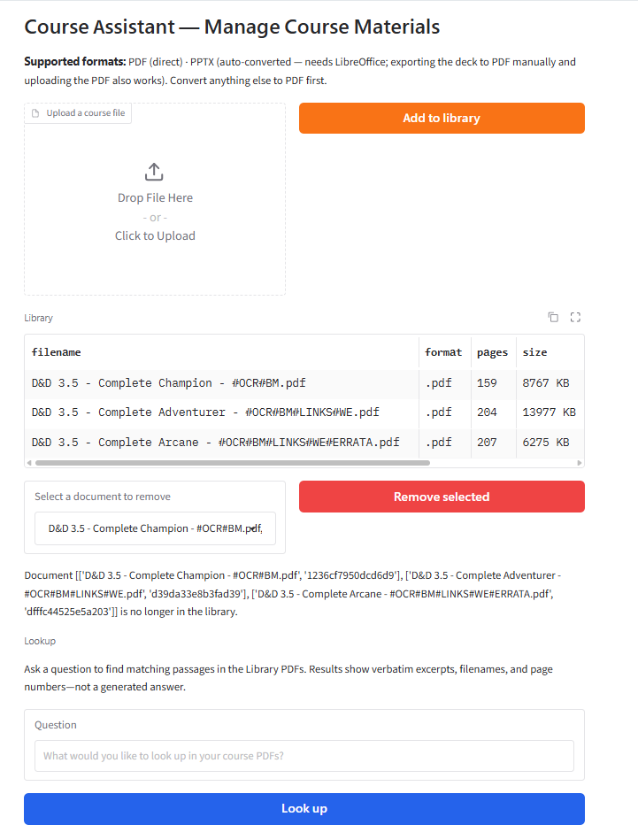
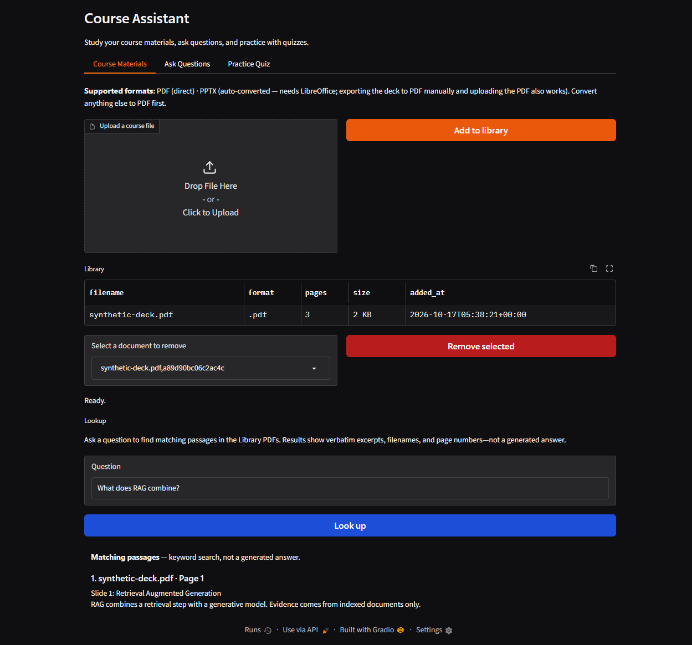

# Course Assistant — MBAX 6418-801 (Assignment 2)


A Python + Gradio course assistant for studying materials downloaded from
Canvas. It combines keyword search, text embeddings, and visual embeddings
with evidence packs containing excerpts and original page/slide images.
Backend modules support source-grounded Q&A and multiple-choice quizzes.

**Status:** The implementation work for Phases 1–6 is merged into `main`;
this Phase 7 README update is on `docs/phase7-readme` for
[issue #9](https://github.com/JoshuaKosakowsky/Course-Assistant_MBAX6418/issues/9),
which remains open. Phase completion does not mean every UI flow is connected.
The Ask Questions tab is a placeholder, and quiz generation needs explicit
provider wiring at startup. See [limitations](#limitations-and-untested-areas).

**CI is green:** the checked `main` run reports **838 passed, 2 skipped,
14 deselected** (roughly 840 offline unit/smoke checks). See the
[verified CI run](https://github.com/JoshuaKosakowsky/Course-Assistant_MBAX6418/actions/runs/39006183798).
Live e2e tests are opt-in and excluded from CI. Older test counts in results
artifacts describe those historical runs, not the current suite.

## Implemented features

| Area | Implemented behavior | Default launch availability |
|---|---|---|
| Materials | PDF/PPTX ingestion, content deduplication, listing, removal | CLI and Course Materials tab |
| Parsing | Per-page text, metadata, original page PNGs | Local PDF parser; PPTX needs LibreOffice |
| Keyword retrieval | BM25 over page-preserving text chunks | Library Lookup works without class calls |
| Hybrid retrieval | BM25 + text vectors + separate visual vectors, fusion, optional rerank | Backend service; depends on configuration |
| Q&A | Vision-model adapter, structured answers, citation/support checks | Backend implemented; Ask Questions tab unconnected |
| Quiz | Evidence-scoped generation, fixed key, hidden solutions, scoring | UI handlers implemented; startup provider missing |

- **Materials:** `python -m app.ingest` accepts PDF and PPTX. Content hashes
  prevent duplicate imports. Removal deletes the registered corpus copy,
  parse artifacts, and searchable content through registered index hooks.
- **Retrieval:** BM25 and ChromaDB text vectors search the same chunks.
  Visual vectors index page images separately. Reciprocal rank fusion (RRF)
  combines ranked candidates; a class multimodal reranker can reorder them.
  Stage warnings make unavailable semantic, visual, or rerank services visible.
- **Evidence and Q&A:** evidence carries document identity, filename, physical
  page number, excerpt, and image provenance. The Q&A backend prompts a
  vision model for structured `{answer, sources}` output, validates citations,
  checks support, and returns a missing-information fallback when validation
  fails. These checks reduce risk; they do not prove factual correctness.
- **Quiz:** choose document IDs, an optional topic, one to five questions,
  and a seed. Each generated quiz has a fixed answer key held on the server.
  Solutions stay hidden until submission or explicit reveal. Submission
  scores answers; feedback includes explanations and source excerpts/images.
  Revealing first ends the attempt without a score.
- **Gradio:** Course Materials, Ask Questions, and Practice Quiz tabs exist,
  plus a separate Lookup section. Only the connected flows should be treated
  as usable from `python -m app.ui` without further integration.

## Quick start from a clean clone

Use **Python 3.12**, the version exercised by CI, and Git. Install LibreOffice
only if you want automatic PPTX conversion. Bring your own authorized course
materials: the local `data/` corpus and real credentials are not committed.
Access to a private repository requires an authorized GitHub account.

```bash
git clone https://github.com/JoshuaKosakowsky/Course-Assistant_MBAX6418.git
cd Course-Assistant_MBAX6418
python -m venv .venv
```

Activate it on macOS/Linux:

```bash
source .venv/bin/activate
```

Or in Windows PowerShell:

```powershell
.\.venv\Scripts\Activate.ps1
```

Install dependencies with the activated environment:

```bash
pip install -r requirements.txt
```

Copy the dummy template on macOS/Linux or in Git Bash:

```bash
cp .env.example .env
```

In Windows PowerShell, the equivalent is:

```powershell
Copy-Item .env.example .env
```

Edit **only the local, gitignored `.env`**. Obtain the actual endpoint details,
authorized model IDs, and keys from the course/team. Replace dummy keys and
placeholder model settings before live use. Do not paste keys into the README,
source code, browser, screenshots, logs, test output, issues, or pull requests.

| Configuration | Purpose |
|---|---|
| `CLASS_API_KEY` | Class vision and embedding clients |
| `CLASS_API_KEY_RERANK` | Reranker key; client falls back to the shared key if unset |
| `BASE_URL_VISION`, `VISION_MODEL` | Vision Q&A and quiz model |
| `BASE_URL_TEXT_EMBED`, `TEXT_EMBED_MODEL` | Semantic text indexing/search |
| `BASE_URL_VISUAL_EMBED`, `VISUAL_EMBED_MODEL` | Page-image and matching visual-space text embeddings |
| `BASE_URL_RERANK`, `RERANK_MODEL` | Candidate reranking |
| `BASE_URL_PARSE` | Template service setting; current PDF parsing is local |
| `APP_HOST`, `APP_PORT` | Gradio bind address and port; defaults are `127.0.0.1:7860` |

The template points to course-provided services at `dobolyi.com`, ports
**9001 and above**. Confirm service assignments with the team rather than
assuming every template entry is deployable. **Port 9000 is reserved for
Hermes operations and is never a class/application service.**

`VISION_MODEL` must be replaced. Treat `VISUAL_EMBED_MODEL` in `.env.example`
as a placeholder too: set it to a model confirmed through authenticated
service discovery. A plausible model string alone does not establish access.
Text and rerank model names have historical live evidence in `results/`;
that evidence does not guarantee present service availability.

```bash
python -m app.ui
```

Open **http://127.0.0.1:7860/** unless you changed the app host/port.
In **Course Materials**, upload a PDF and select **Add to library**.
The app parses it and attempts the configured indexing stages. Use **Lookup**
to find exact passages; click **Look up** or press Enter.

Startup rebuilds in-memory BM25 from the library and parsed artifacts and
reuses existing text vectors. Missing vectors may require live embedding
requests. With unavailable embeddings, keyword retrieval remains available;
production never substitutes fake embeddings. A fresh clone starts empty.

The Ask Questions tab does not yet accept questions. Practice Quiz controls
are present, but Generate reports that generation is not connected until a
provider is passed to `build_ui`. Configuration alone does not wire either flow.

### CLI ingestion and indexing

```bash
python -m app.ingest path/to/material.pdf
python -m app.ingest path/to/slides.pptx
python -m app.indexing
```

Ingestion registers and parses the file; the separate indexing command builds
retrieval indexes. The UI also indexes successful new uploads automatically.
These indexing operations can call shared class services when configured.

```bash
python -m app.indexing --keyword-only
python -m app.indexing --reindex
python -m app.indexing --visual-backfill
```

- `--keyword-only` skips semantic and visual indexing for that command.
- `--reindex` clears/rebuilds text indexes; use it when switching text
  embedding models because stored vectors have a fixed dimension.
- `--visual-backfill` explicitly re-embeds library page images. Startup does
  not automatically perform a first full-library visual backfill. It fails
  with a nonzero exit if the visual index is unavailable.

### Supported formats and local storage

| Input | Handling | Requirement |
|---|---|---|
| PDF | PyMuPDF text extraction and 150 dpi page PNG rendering | Python dependencies |
| PPTX | Headless conversion to PDF, then the same parser | LibreOffice |
| Other formats | Rejected with conversion guidance | Export to PDF first |

The converter finds `soffice` on PATH or in standard Windows locations.
Set `LIBREOFFICE_SOFFICE` in the local environment/`.env` for a custom path.
Without LibreOffice, export the deck to PDF manually and upload that PDF.
Inspect converted slide images before relying on their layout.

`data/` is gitignored and holds local materials, library records, parsed
artifacts, and persistent indexes. `DATA_ROOT` can override the storage root.
Neither a clean clone nor the offline test suite needs the team's course files.

## Architecture

```text
course PDF/PPTX -> parse locally (text + original page/slide images)
                      |
                      +-> page-preserving text chunks
                      |       +-> keyword index (bm25s) -----------+
                      |       +-> text embedding index (Chroma) --+
                      |                                          |
                      +-> page images -> visual embedding index --+
                                                                 |
                        RRF fusion + page aggregation <-----------+
                                      |
                           optional multimodal rerank
                                      |
                          evidence pack (text + images)
                              /                   \
                 vision Q&A backend          quiz provider + model
                 {answer, sources}           server-held quiz/session
                              \                   /
                          Gradio integration boundary
                    Q&A pending; quiz provider injection needed

BM25 keyword index -> Library Lookup -> verbatim passages in Gradio
```

Text and visual indexes remain **separate**. Visual text queries use the same
visual model as image indexing; equal vector dimensions do not make the
text-embedding model interchangeable with the visual model.

Fusion preserves contributing methods and source identity. Page aggregation
limits the advantage of long pages with many chunks. Original manifest-vetted
images remain the citation authority; resized embedding copies do not replace
originals. Unverified external visual hits must not become cited originals.

Core entry points are [ingest](app/ingest.py), [indexing](app/indexing.py),
[retrieval](app/retrieval.py), [Q&A](app/qna.py),
[quiz provider](app/quiz_provider.py), and [Gradio UI](app/ui.py).
For provider injection and evidence boundaries, read
[QUIZ_INTEGRATION.md](docs/QUIZ_INTEGRATION.md).

## Screenshots



This existing committed screenshot shows **Lookup**, using a generated
synthetic PDF. It demonstrates source lookup, not generated Q&A or a live quiz.
[lookup-check.md](results/lookup-check.md) records the browser verification.



A second **Lookup** capture (2026-10-17) from a live run against the class
keyword + embedding retrieval services with a three-slide synthetic deck:
the query "What does RAG combine?" returns a verbatim excerpt with document
name and page number. Content shown is synthetic only.

Q&A and quiz flow screenshots are being captured and will be added after the
corresponding flows are connected and verified. They are not included here;
no placeholder or generated screenshots stand in for working flows.

## Findings and design decisions

### Chunk size: fewer records, no measured quality difference

The [chunk-size comparison](results/chunk-size-comparison.md) uses four
synthetic pages, four queries, BM25 only, and 64-character overlap.

| Chunk size (characters) | Chunks | Accuracy@1 | Hit Rate@3 | MRR@3 |
|---|---:|---:|---:|---:|
| 250 | 25 | 100% | 100% | 1.000 |
| 500 | 13 | 100% | 100% | 1.000 |
| 1,000 | 7 | 100% | 100% | 1.000 |

Larger chunks reduced record count without changing measured retrieval on
this easy synthetic set. This does not establish an optimum for real course
questions or measure latency/memory. The code still defaults to **512-character
chunks with 64-character overlap**; the comparison did not change that default.
See the [CSV](results/chunk-size-comparison.csv) and
[per-query details](results/chunk-size-details.json).

### BM25 and semantic retrieval cover different failures

The [BM25 demo](results/keyword-bm25-demo.txt) finds exact course vocabulary
but misses “what is a firm worth” when the source uses different wording.
The [semantic demo](results/semantic-search-demo.txt) retrieves finance for
“company purchase price estimation” where BM25 finds nothing. It also ranks
operations above finance for “what is a firm worth” on its tiny corpus.
Embeddings help with wording changes but can still choose the wrong passage.

The [fusion demo](results/fusion-demo.txt) supports keeping both retrieval
methods: in its live section, keyword evidence corrects the semantic top
result for “inventory management,” while semantic hits cover zero-match
keyword queries. Its fake-embedding section checks mechanics, not meaning.
These demos use different synthetic corpora and are not one shared benchmark.

### Reranking helped this sample; images did not always help

The [initial rerank demo](results/rerank-demo.txt) records both text-only and
image-aware reranking with live services; expected documents were already
first in its four examples, so it does not show a top-1 improvement.
The later [evaluation](results/e2e-evaluation.txt) scores exact source pages
for five answerable questions over three synthetic PDFs:

| Retrieval stage | Correct top-1 pages | Relevant page in top 3 |
|---|---:|---:|
| Fusion, before rerank | 1/5 | 5/5 |
| Text-only rerank | 5/5 | 5/5 |
| Image-aware rerank | 4/5 | 5/5 |

Use the [reconciled metrics](results/e2e-evaluation-metrics.txt): text-only
reranking improved four questions versus fusion; image-aware improved three.
Adding images worsened the chart question relative to text-only reranking.
The out-of-scope sixth question still retrieved unrelated evidence and was
excluded from accuracy scores. These are retrieval results, not generated
answer accuracy or proof of reliable abstention.

### Visual integration and hardening establish boundaries

The [live visual integration log](results/fusion-visual-integration.txt)
records three queries with visual retrieval and multimodal reranking. Expected
page positions were unchanged; the chart page remained second. This shows a
working integration path in that capture, not a demonstrated quality gain.

The [offline hardening evaluation](results/hardening-eval.txt) uses fake
embeddings. It checks that a visual-only page reaches reranking without an
invented excerpt, page fusion avoids a many-chunk advantage, a mismatched
image stays unverified, and visual-service failure preserves text evidence.
It establishes behavior under those cases, not live retrieval quality.

The [indexing demo](results/indexing-demo.txt) records index counts, removal,
restart persistence, live CLI use, and recovery from vector-dimension mismatch.
The [startup check](results/app-startup-check.txt) records HTTP 200 and no
embedding requests when all required text vectors already existed. Its
captured console output predates later visual startup wiring.

## Testing and verification

```bash
pytest                  # default: offline unit + smoke
pytest -m unit          # logic only
pytest -m smoke         # component wiring on synthetic fixtures
```

CI runs `pytest -m "unit or smoke"` and a secret scan on pushes/PRs using
Python 3.12. Unit/smoke tests inject model/embedding responses rather than
calling shared endpoints. See [TESTING.md](docs/TESTING.md) for tier rules.

Live checks are deliberate opt-in usage of the shared course infrastructure:

```bash
pytest -m e2e
```

They require complete local credentials, network access, and available services;
unconfigured cases skip. Live quiz tests additionally require `RUN_LIVE_QUIZ=1`,
as described in [QUIZ_INTEGRATION.md](docs/QUIZ_INTEGRATION.md).
Visual request format and roundtrip scope are documented in
[VISUAL_EMBEDDINGS.md](docs/VISUAL_EMBEDDINGS.md).

## Limitations and untested areas

- **Q&A UI is not wired.** `app/ui.py` displays a placeholder in Ask Questions;
  there is no connected retrieval/model answer callback in that tab.
- **Quiz startup is not wired.** The entry point calls `build_ui(store, indexer)`
  without `quiz_provider`. Generate works only after supplying a provider;
  filling `.env` does not make the current launch generate questions.
- **Visual model configuration is provisional.** The model name in
  `.env.example` is a placeholder requiring an authenticated model check.
  The template must not be treated as a guarantee of service/model access.
- **Image retrieval quality beyond same-image roundtrip is untested as a
  general capability.** Historical live integration examples exist, but they
  do not establish representative text-to-image or chart retrieval quality.
  The current visual e2e scope is embedding/indexing/same-image roundtrip.
- **Live use needs class services.** Semantic/visual indexing, reranking,
  and model generation depend on course access and availability. Local PDF
  parsing and BM25 Lookup work offline; full generation does not.
- **Port 9000 is reserved for Hermes.** Never use it for a class service.
- **Evidence validation is not factual proof.** Default Q&A support checking
  uses heuristics; valid quiz source identity does not prove an answer correct.
  Broad live factual-answer and adversarial evaluation remain outstanding.
- **Synthetic evaluations are small.** Reported scores do not establish
  performance on the full course corpus, real student questions, or other
  courses. Unrelated retrieval for out-of-scope questions remains possible.
- **Quiz coverage is sampled.** The provider retrieves eight candidates and
  retains at most four image-bearing references plus text-only evidence.
  It does not exhaustively review every selected document. Topic filtering
  is literal excerpt matching and excludes image-only pages with a topic.
- **A seed does not make remote generation repeatable.** Stable option
  placement assumes identical generated questions. Optional server replay is
  bounded and process-local; eviction/restart can yield a different generation.
- **Parsing has practical limits.** Lookup needs extracted PDF text and adds
  no OCR; it excludes original PPTX records. PPTX layout fidelity needs visual
  review. Lookup results are snapshots; rerun after library changes.
- **Verification remains incomplete.** A fresh-clone setup was not executed
  for this README edit, and complete live browser Q&A/quiz flows, concurrent
  user behavior, and representative retrieval quality are not established
  by the committed results. No new live tests were run for this rewrite.

## Repository conventions and navigation

| Reference | Purpose |
|---|---|
| [AGENTS.md](AGENTS.md) | Operating rules for coding agents |
| [CONTRIBUTING.md](CONTRIBUTING.md) | Human workflow, reviews, bug reports |
| [PLAN.md](PLAN.md) | Phase goals and acceptance checks; some status text is historical |
| [docs/](docs/) | Technical and collaboration documentation |
| [COMMITS.md](docs/COMMITS.md) | Commit types, imperative subjects, 50-character subject limit |
| [TESTING.md](docs/TESTING.md) | Offline unit/smoke and opt-in live e2e tiers |
| [PERSONA.md](docs/PERSONA.md) | Evidence-first assistant behavior and voice |
| [QUIZ_INTEGRATION.md](docs/QUIZ_INTEGRATION.md) | Provider wiring, evidence trust, replay, live quiz gates |
| [VISUAL_EMBEDDINGS.md](docs/VISUAL_EMBEDDINGS.md) | Multimodal request format, model compatibility, verification scope |
| [results/](results/) | Committed comparison logs, findings, and screenshot evidence |
| [GitHub issues](https://github.com/JoshuaKosakowsky/Course-Assistant_MBAX6418/issues) | Ownership, remaining work, acceptance tracking |

Use one issue, one branch, and one PR for each contribution. Claim the issue,
follow commit conventions, run the appropriate offline checks, review the diff
for secrets, and state what was tested and what remains untested in the PR.
Real keys belong only in the local gitignored `.env`; committed examples must
contain dummy values. Course materials remain local under gitignored storage.
